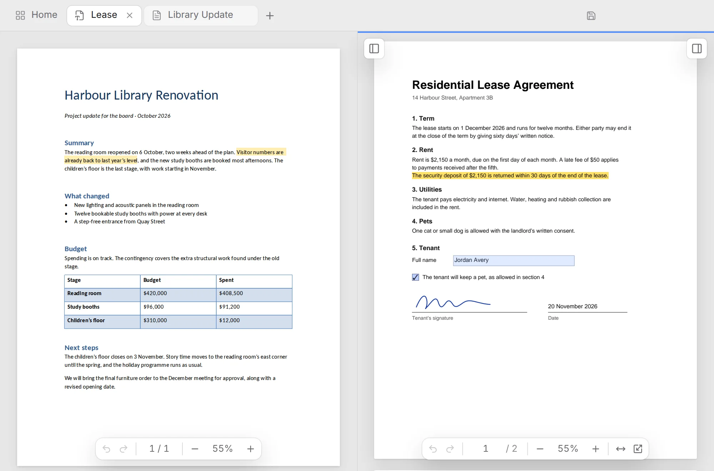

  

<h1 align="center">Writan</h1>

A fast, local app for Word, PowerPoint, Excel, PDF and Markdown, with live collaboration and AI agents built in.

  <a href="https://github.com/elijahroizman/writan/releases/latest"><strong>Download</strong></a> ·
  <a href="./docs/README.md">Docs</a> ·
  <a href="./CHANGELOG.md">Changelog</a> ·
  <a href="https://github.com/elijahroizman/writan/issues">Issues</a>

  <picture>
    <source media="(prefers-color-scheme: dark)" srcset="./.github/readme/hero-dark.webp" />
    
  </picture>

Writan opens the documents most people actually use: Word, PowerPoint, Excel, CSV, PDF, Markdown, plain text and images. Each one is a tab in a single window, and an optional plugin adds LaTeX.

It runs on macOS, Windows and Linux. The installer is about 25 MB, there's no account to make, and your documents stay on your computer unless you choose to share one.

## What you get

- **Fast.** Writan is built on [Tauri](https://tauri.app), so it uses the system's web view instead of shipping a browser. Each document engine loads the first time you open that kind of file, so someone who only writes Markdown never loads the Office engine.
- **Edit together, live.** Share a Word document, presentation or workbook, and other people join with a six-digit code. Everyone sees each other's changes, carets and selections as they type. The file stays on the sharer's computer, and what crosses the internet is encrypted.
- **AI agents inside your documents.** Claude Code, Codex, Antigravity, Grok Build, Hermes Agent and Pi can join a document you have open and work in it beside you. An agent writes and formats text, builds slides and fills in cells and charts, then looks at the pages as pictures to check its work. Its caret and name show up like a person's. **Settings › AI** connects each agent in one click.
- **Its own Office engine.** Word, PowerPoint and Excel files open in an engine written in Rust in this repository and compiled to WebAssembly. It keeps the parts of a file it doesn't edit, so saving never drops them, and it calculates about 140 Excel functions itself.
- **PDFs you can work with.** Edit a PDF as a Word document. Sign it with a signature you draw, type or photograph, fill in its forms, and move, rotate, insert or extract pages. Scanned pages are read with offline OCR, so Find works on them too.
- **LaTeX when you want it.** The plugin compiles `.tex` files with the TeX on your computer and shows the PDF beside the source. If TeX isn't installed, Writan offers to install it.
- **Open.** The source code is MIT licensed, and you can build every part of it yourself.

## Install

### Desktop app

Download the latest build from [Releases](https://github.com/elijahroizman/writan/releases/latest).

| Platform | What to do |
| --- | --- |
| macOS | Open `Writan_…_aarch64.dmg` on Apple silicon, or `Writan_…_x64.dmg` on Intel, and drag Writan to Applications. The app is signed and notarized by Apple, so it opens without a warning. |
| Windows | Run `Writan_…_x64-setup.exe`. Windows code signing is coming soon. Until then, Windows may say it protected your PC the first time: click **More info**, then **Run anyway**. Updates are signed and checked either way. |
| Debian, Ubuntu | `sudo apt install ./Writan_…_amd64.deb`, or `Writan_…_arm64.deb` on ARM. Needs Ubuntu 22.04 or Debian 12 or newer. |
| Fedora | `sudo dnf install ./Writan-…x86_64.rpm`, or `Writan-…aarch64.rpm` on ARM. |
| Arch Linux | `sudo pacman -U ./writan-…-x86_64.pkg.tar.zst`, or `writan-…-aarch64.pkg.tar.zst` on ARM. |

Writan updates itself. On a Mac or Windows PC, a new version downloads in the background and installs when you quit. On Linux, the package adds Writan's APT, dnf or pacman repository, so new versions arrive with your other system updates. You can choose between the stable channel and nightly builds of the newest code. [Updating](./docs/user/updating.md) explains both.

### Command line

The `writan` command opens files and folders from a terminal: `writan .` opens the folder you're in, and `writan notes.md` opens a file. The Linux packages install it. On a Mac, turn it on in **Settings › General › Command line**.

### Connect an agent

Install an agent such as [Claude Code](https://claude.com/product/claude-code) or [Codex](https://developers.openai.com/codex/cli) and sign in to it. Then open **Settings › AI** in Writan and connect it. Any other agent that takes a remote MCP server can use the address shown there.

## Why another document app?

Word, PowerPoint and Preview take seconds to open and a lot of memory to keep running, and most of the time you only need them to read a file, change a paragraph or sign a page. Writan was built for those moments. It opens fast, keeps every document in one window and works offline.

Collaboration and AI agents are part of the app rather than an add-on to a cloud service. You don't upload a file to a website to edit it with someone, and an agent edits the same document you're looking at instead of handing you a copy.

## Privacy

Writan sends anonymous usage data, such as which file types are opened and how long they take, so we know what to fix. It never sends your documents, file names or anything you type. You can turn it off in Settings, and it starts off in Europe and the UK. [PRIVACY.md](./PRIVACY.md) lists exactly what is sent.

## Documentation

- [What each editor can do](./docs/user/features.md)
- [Keyboard shortcuts](./docs/user/keyboard-shortcuts.md)
- [Plugins: images and LaTeX](./docs/user/plugins.md)
- [Updating and release channels](./docs/user/updating.md)
- [What it doesn't do yet](./docs/user/limitations.md)

[All docs](./docs/README.md) has the full list.

## Contributing

Bug reports and ideas are welcome in [issues](https://github.com/elijahroizman/writan/issues). Pull requests are welcome too, but there's no guarantee one gets merged, so open an issue first for anything large.

- Read [CONTRIBUTING.md](./CONTRIBUTING.md) before you open a pull request.
- Build from source with the [development guide](./docs/internals/development.md).
- AI agents must follow [AGENTS.md](./AGENTS.md), which lists the models allowed to open a pull request.

## License

The source code is licensed under the [MIT License](./LICENSE).

Writan is built on open-source engines and fonts, including [PDFium](https://pdfium.googlesource.com/pdfium/) through [EmbedPDF](https://github.com/embedpdf/embed-pdf-viewer), [CodeMirror](https://codemirror.net), [markdown-it](https://github.com/markdown-it/markdown-it) and the Carlito, Caladea and Liberation fonts. **Settings › General › Open-source licenses** lists every one with its license.

Writan's themes follow [T3 Code](https://github.com/pingdotgg/t3code)'s, by T3 Tools Inc. That covers the theme picker, the theme editor and its color picker, custom CSS and how it's kept from loading files, the Open VSX theme search, and the tools that let an agent restyle the app. Parts of that code are adapted from T3 Code under its MIT license ([assets/third-party/T3-Code-LICENSE.txt](./assets/third-party/T3-Code-LICENSE.txt)).
